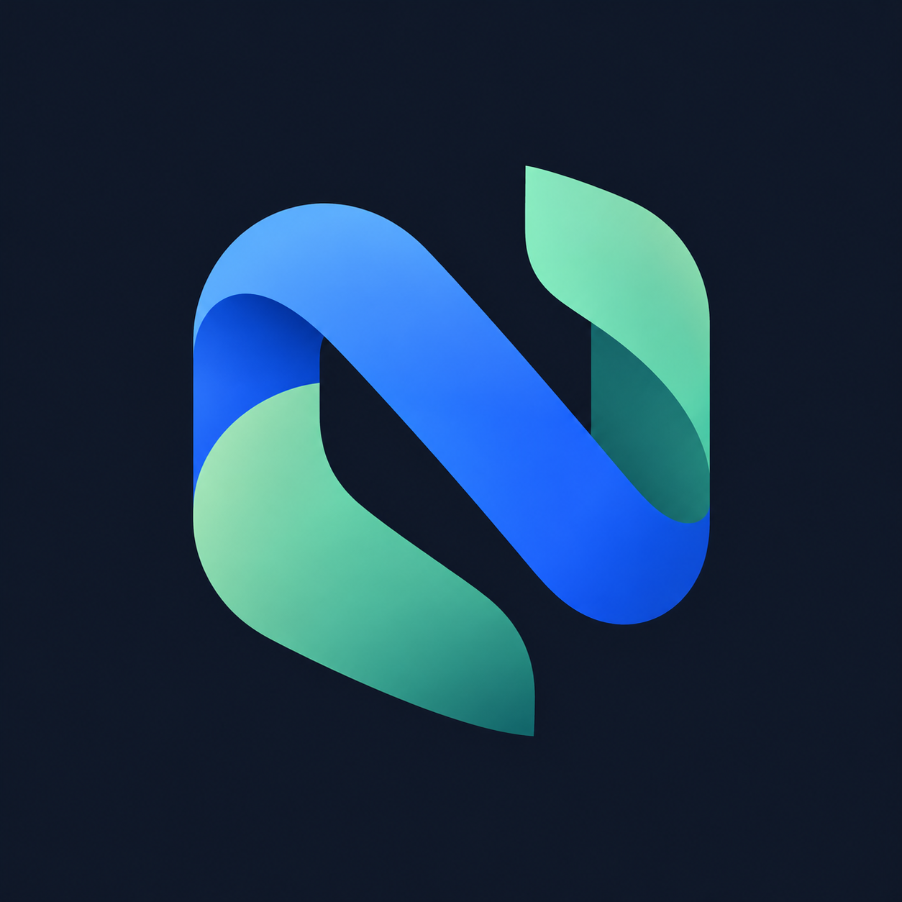
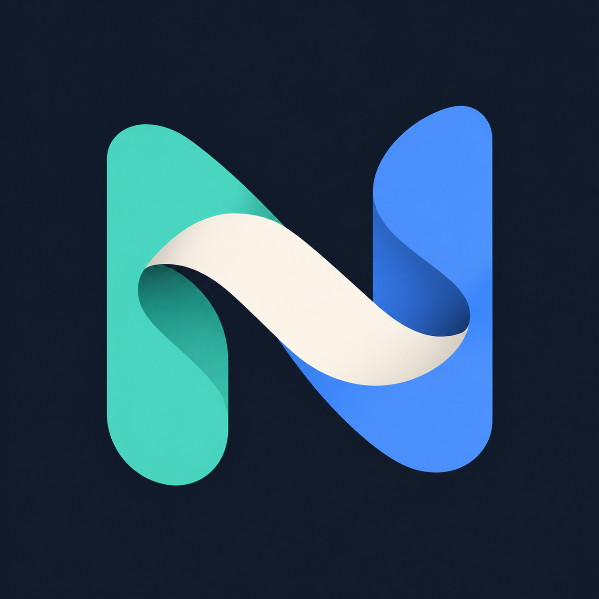
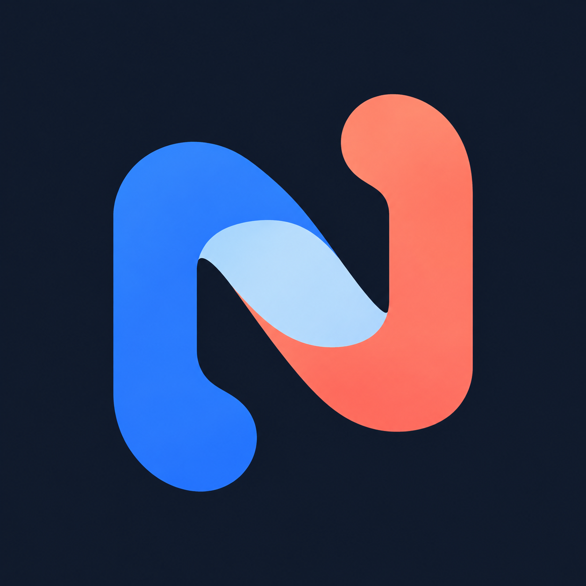

# Nexus 图标候选 G01–G15

日期：2026-11-03。状态：概念探索，未选定正式应用图标。

参考方法：[logo-design skill](https://github.com/kaankiziltug/logo-design-skill/blob/main/skills/logo-design/SKILL.md)。仅阅读并采用设计方法，未执行第三方脚本。使用内置 imagegen，每个候选独立生成。

目标：连接寓意、自然转折、灵动轮廓、隐藏 N、冷色为主且避免单调。原图全部保留，不替换现有应用资源。

评审：优先比较 G08（连接）、G14（灵动）、G15（紧凑轮廓）。G06 配色克制但偏静态；G05/G13 交织偏复杂；G01/G03/G04/G07/G10 的 N 偏直接。生成结果未完全遵循平面化、隐藏字母的目标。尚未完成小尺寸、单色、相似商标排查；概念不能视为已通过发布验收。

## 原图与完整提示词

通用提示词：

```text
Use case: logo-brand. Create ONE sophisticated original app icon concept for Nexus, a local-first personal knowledge and engineering work platform. Square 1024x1024. Mark centered occupying 65% on a uniform very dark blue-gray background; no enclosing app tile. Lively, calm, confident, professional custom brand design, clear even at small size. Vector-friendly clean broad shapes, natural tangential turns, generous internal gaps, at most three colors, very subtle surface shading only, no glossy plastic, no heavy extrusion, no glow, no text, no labels, no watermarks, no mockup. Connection is the central idea; a hidden N must arise naturally rather than a forced font glyph. Avoid stock infinity, generic AI sparkle, hexagonal cubes, piles of rectangles, existing famous app logo imitations. Specific concept: [specific concept below]
```

### G01 双带交织



```text
Two broad flowing bands interlace exactly once, cobalt and muted jade, forming a compact asymmetric upright silhouette; the negative-space channel between them subtly reads N. Soft purposeful curves, open ends, restrained dimensional overlap.
```

### G02 负形桥


```text
A single compact indigo pebble-like abstract mark split by an elegant curved diagonal negative-space passage that hints N; one small seafoam connecting surface. Strong silhouette, no literal printed letter.
```

### G03 柔性折带


```text
A continuous broad ribbon rises left, sweeps diagonally down, then rises right, subtly implying N through relaxed organic folded geometry. Deep blue and pale periwinkle surfaces with a small muted copper underside, crisp silhouette.
```

### G04 连接双叶


```text
Two substantial sculpted leaf-like strokes linked by one diagonal curved bridge, suggesting knowledge connecting into action; N is a secondary structural reading. Teal and ultramarine, slight asymmetry, no botanical veins, no bird silhouette.
```

### G05 开放结


```text
An open, loose woven knot with only two crossings, broad navy and glacier-blue bands plus a tiny muted apricot return surface. Distinct compact silhouette, N emerges within its inner opening; avoid infinity symbol and pretzel.
```

### G06 交汇石


```text
Two interlocking rounded asymmetrical stone-like solid shapes, one dusty violet and one muted ice teal, a single deep diagonal channel between them hiding a subtle N in negative space. Flat graphic sophistication, compact poised silhouette, not yin-yang, no ribbon.
```

### G07 知识书脊


```text
Two curved upright page-like planes connected by a short diagonal woven spine; abstract knowledge junction, N discovered through the gap. Petrol blue, pale silver blue, tiny warm terracotta seam. Compact mark, no literal book outline, flat restrained graphic.
```

### G08 错位双环


```text
Two incomplete rounded trapezoidal links offset diagonally and interlocked once. Their shared inner negative space suggests N. Broad smooth band sections, indigo and restrained turquoise; no chain clipart, no infinity, no literal typographic N. Flat almost planar.
```

### G09 山径


```text
Abstract compact emblem of two softly rounded rising ridges linked by a diagonal path; hidden N cut through negative space. Slate blue and pale cyan with a muted coral inset. Organic tension, natural contour, no landscape scene or literal mountains, only one clean emblem.
```

### G10 编织节点



```text
Three short broad tapering woven strands converging in a central diagonal junction with two upright outer strokes; subtly hint N without drawing a conventional N. Asymmetrical rounded silhouette, teal, cornflower blue, soft ivory. Flat color surfaces, one over-under crossing, no star or flower.
```

### G11 榫合


```text
A compact near-circular abstract joint made of two gently hooked solid pieces locking diagonally together, hidden N appears in the generous central cutout. Flat mineral blue and soft sage, tiny off-white joining face. Elegant engineered fit with organic outer contours, no yin yang or recycling symbol.
```

### G12 汇流窗口


```text
One asymmetrical softly rounded squircle-shaped open frame with a broad diagonal interior bridge; two open corners produce a hidden N in the background space. Flat deep lavender and ice blue with one muted amber connection. Compact graphic emblem, no literal N glyph, no cube, no 3D extrusion.
```

### G13 流线织梭


```text
A compact diagonal woven shuttle shape, two broad curved interlocking loops stretched gently upward; a subtle N exists in the sequence of internal spaces. Petrol teal, muted periwinkle and pearl. Clean planar graphic, no ribbon tails, no bow, no infinity symbol, no atom or orbit.
```

### G14 双向接力



```text
Two gently bent thick strokes, opposing upright comma-like terminals, one short off-center diagonal bridge creates a subtle N. Slight rotational tension and lively asymmetry, coherent natural curves. Flat cobalt and desaturated coral with a small icy blue joining surface. No ribbon shading, no typography, no arrowheads.
```

### G15 留白织印


```text
A single bold irregular rounded diamond emblem made of two interwoven broad color fields; a wide gently curving N-shaped negative-space incision passes through center, hidden rather than printed. Flat midnight periwinkle and pale turquoise, very small warm ivory crossing. Compact stamp-like silhouette with deliberate flowing curves; no literal diamond gemstone, no hexagon, no cubes.
```

