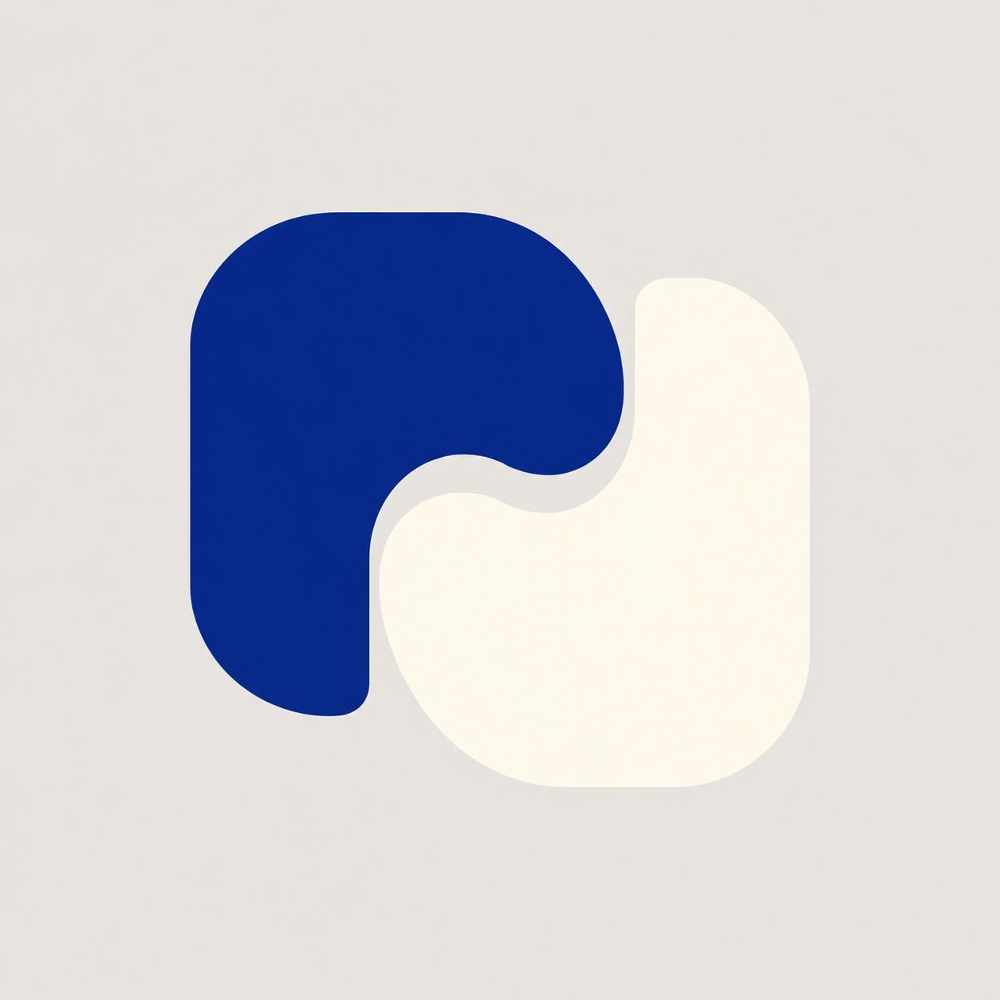
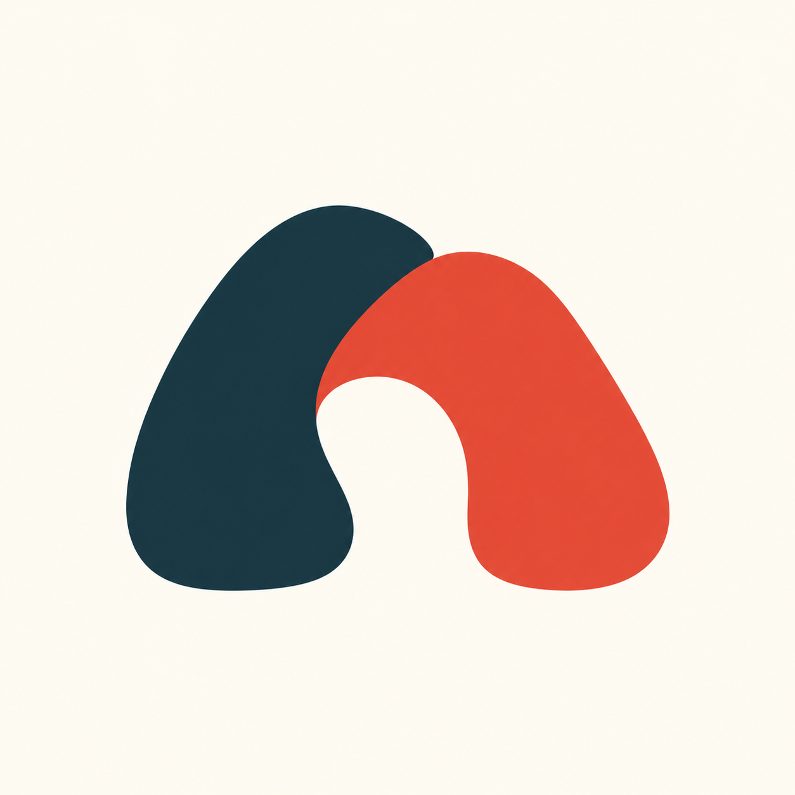
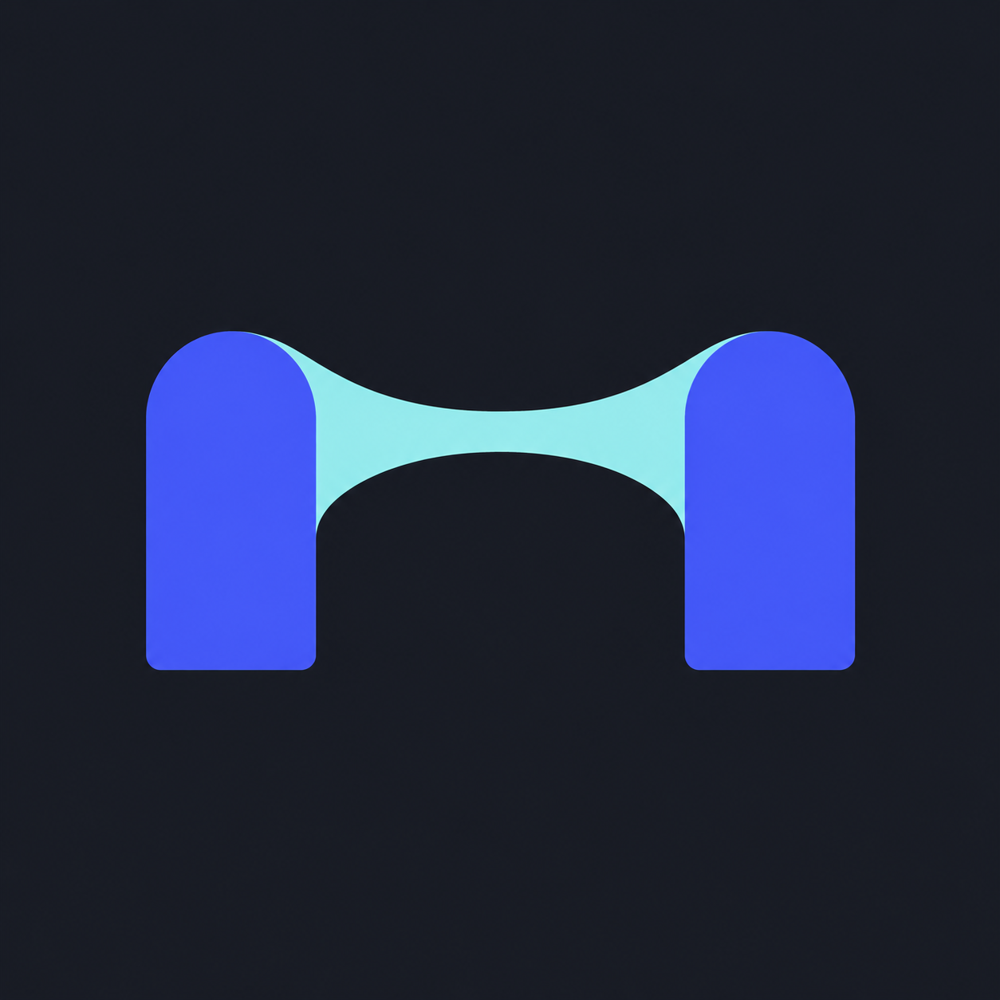
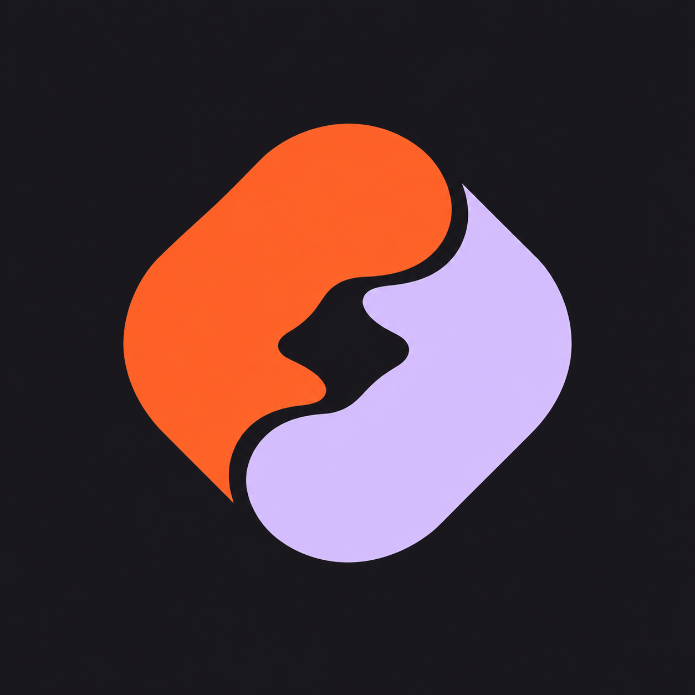
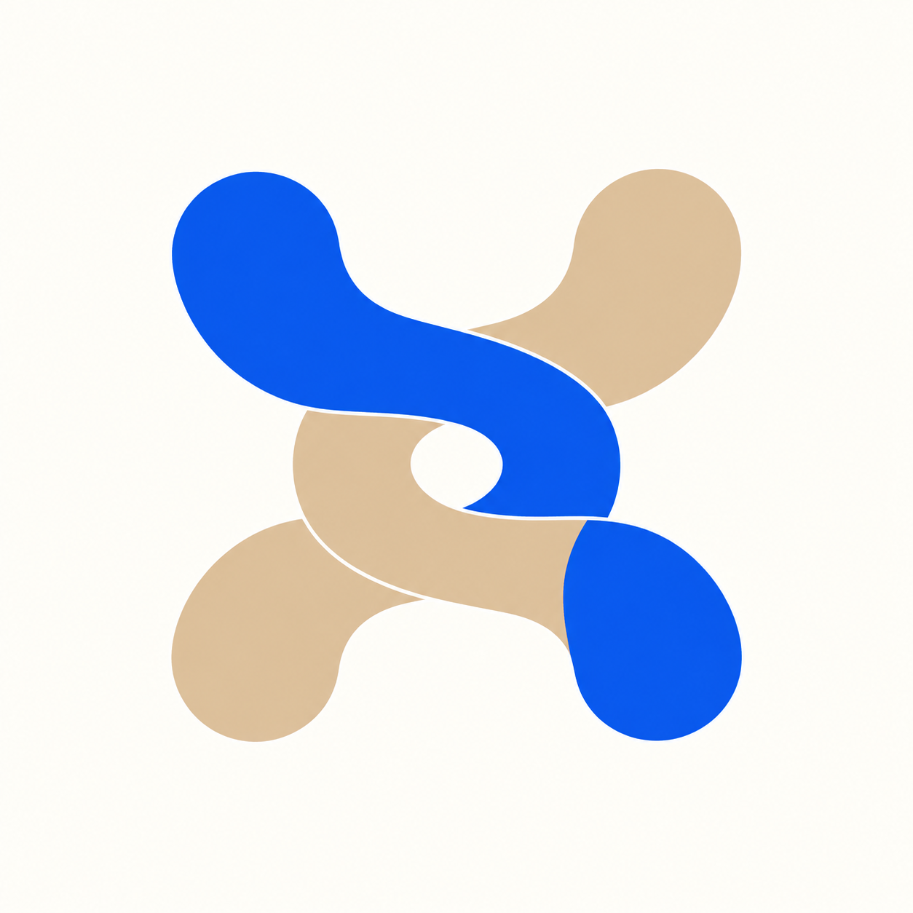

# Nexus 连接主题图标 H01–H10

日期：2026-11-03。状态：概念候选，未选定正式图标。

本轮按用户指示放下此前隐藏 N、编织带、冷色等限制，仅保留“连接”主题。沿用 [logo-design skill](https://github.com/kaankiziltug/logo-design-skill/blob/main/skills/logo-design/SKILL.md) 的单一构思、轮廓辨识和留白方法，使用内置 imagegen 独立生成十张原图。未执行第三方脚本。

视觉评审：优先比较 H02（温暖相遇）、H04（工程扣合）、H08（知识连接）。H01 浅色与背景对比不足；H03 易被读成哑铃；H05 偏汇聚且并未实际相连；H06 偏功能符号；H07 连接处略生硬；H09 负形有面部联想；H10 交叠偏复杂。所有结果均是探索稿，尚未完成小尺寸、单色及相似性检查。

## 提示词与原图

通用提示词：

```text
Use case: logo-brand. Design ONE original premium app icon symbol for Nexus, a thoughtful local-first personal knowledge and engineering work platform. The sole conceptual theme is CONNECTION. Discard all prior icon constraints: do NOT hide an N and do NOT default to woven flowing ribbons. Seek a memorable ownable silhouette, one simple visual idea, strong figure-ground relationship and natural geometry. Square canvas 1024x1024, one centered mark occupying about 62% of canvas, uniform background, no enclosing rounded-square tile, no text or numbers, no mockup, no watermark. Professional vector-like brand exploration: crisp edges, carefully balanced optical weight, generous gaps, mostly flat color, at most 3 colors. Avoid glossy 3D plastic, bevels, shadows, neon gradients, excessive detail, familiar famous app logo imitations. Specific concept: [specific concept below]
```

### H01 共榫



```text
Two bold solid asymmetrical forms interlock with a single precisely fitted curved joint, like a beautifully crafted joinery connection. Compact almost square silhouette, generous negative space. Flat deep ultramarine and warm ivory on a uniform pale warm-gray background. No ribbon, no letter, no chain clipart.
```

### H02 相遇



```text
Two short thick organic arch forms gently lean into a shared central connection, making an unexpected compact unified emblem with one small open space. Flat dark petrol and muted vermilion on ivory. Sculptural graphic simplicity, slight asymmetry, inviting but professional, no heart, no infinity.
```

### H03 桥间



```text
A bold single abstract bridge composed of two rounded piers joined by a gently rising solid central span, seen as a flat symbol rather than architectural illustration. Rich indigo mark with a small pale aqua connection plane on dark graphite. Strong distinctive negative space, no letter N, no cables.
```

### H04 扣合


```text
Two open rounded angular links dock together at an offset seam, forming a balanced compact emblem with an unusual stepped outer silhouette. Flat cobalt and pale chartreuse on deep navy. Broad solid areas, seamless graphic construction, no 3D ribbon, no infinity, no conventional chain icon.
```

### H05 共点


```text
Three broad short petal-like solid pieces meet around one small rounded triangular negative space, expressing connected knowledge. Unequal sizes create poised asymmetry. Flat midnight blue, dusty coral, muted sky blue on ivory. No flower illustration, no AI sparkle, no sixfold knot.
```

### H06 汇流


```text
Two wide tributary-like channels merge into one shared solid stream in a compact organic abstract symbol. A single vivid azure shape with a subtle warm silver-blue joining insert on dark ink. Bold flat shapes and purposeful flowing edges, no letterform, no wave clipart, no gradient swoosh.
```

### H07 同轨


```text
Two thick incomplete circular arcs share one short off-center linking segment; offset openings give the mark its own identity. Compact circular silhouette with excellent negative space. Flat dark plum and soft mint on light limestone. No orbit illustration, no atom, no infinity, no recycling arrows.
```

### H08 连页


```text
Two substantial abstract folded page forms connect through one rounded shared spine, creating an elegant compact emblem of knowledge linked to action. Flat forest teal and warm porcelain with a small muted blue face, on deep green-black. Avoid literal open book, no N monogram, no ribbon tails.
```

### H09 嵌合



```text
One irregular rounded lozenge made of two complementary solid pieces, joined by a distinct smooth S-shaped seam. Strong almost seal-like silhouette, a small deliberate central cutout makes the connection legible. Flat persimmon and cool pale lilac on charcoal. No yin-yang, no globe, no letters.
```

### H10 交汇印



```text
An original abstract junction mark: four broad curved arms pair into two connected paths with exactly one clean over-under intersection and a small central opening. Asymmetrical compact silhouette with optical balance. Flat royal blue and soft sand on ivory. No plus sign, no Celtic knot, no hashtag, no corporate stock swirl.
```

