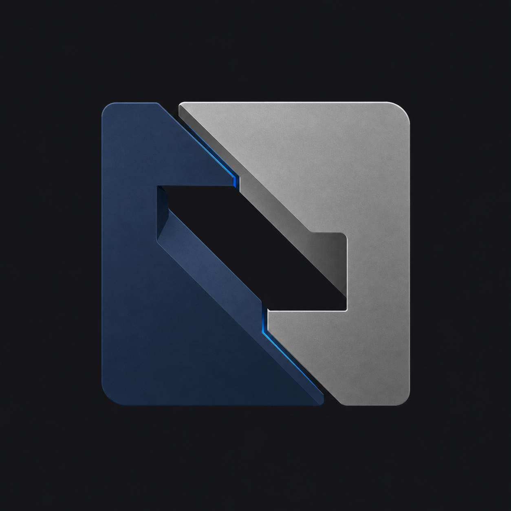
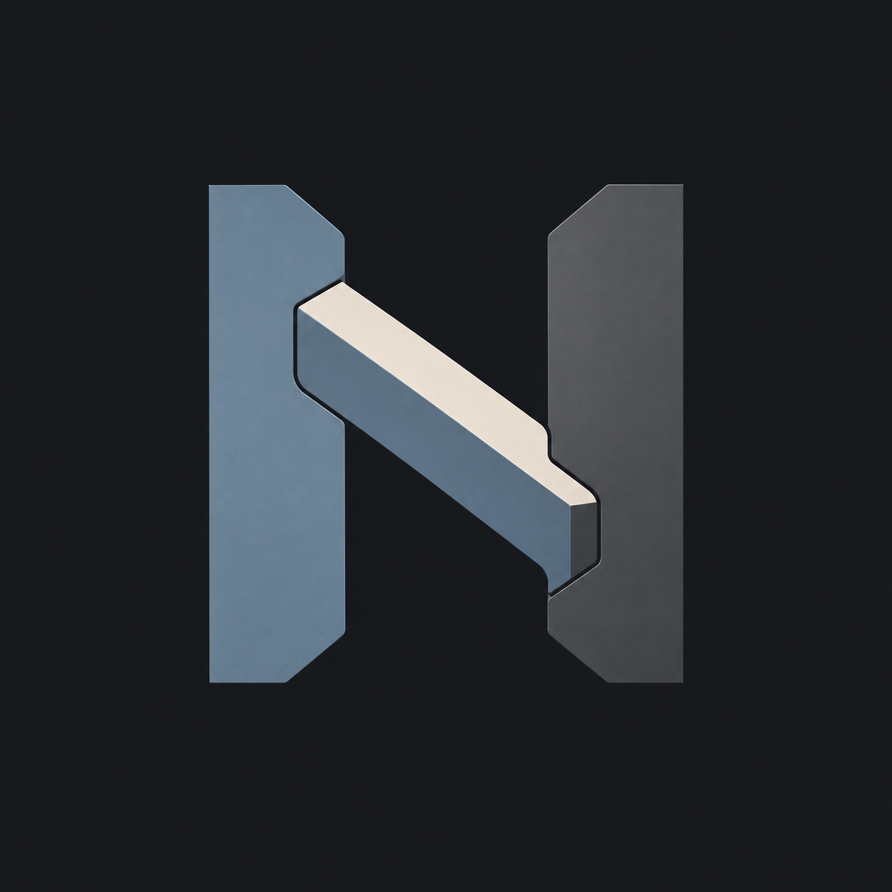
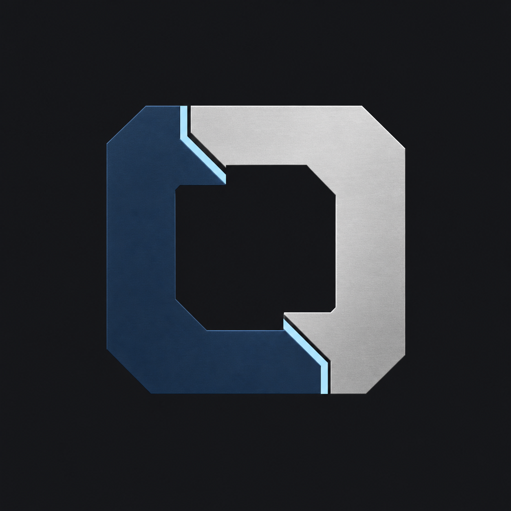
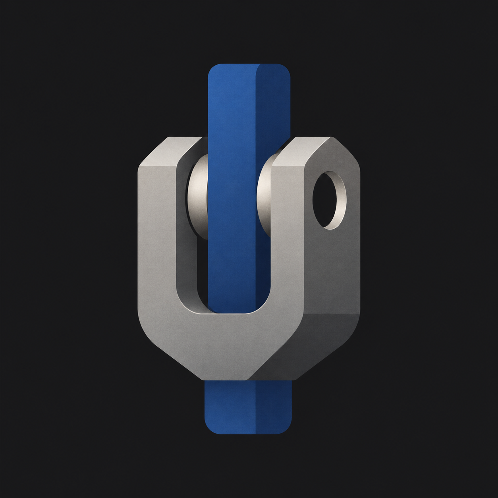
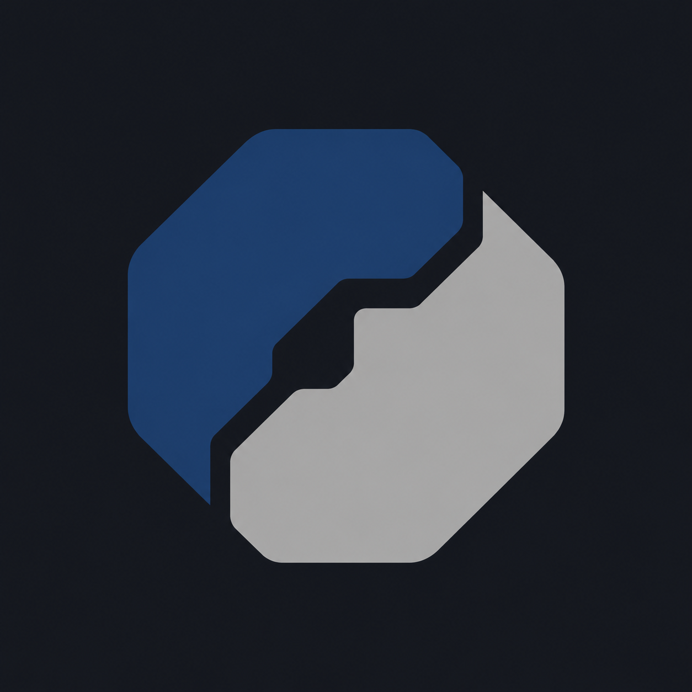
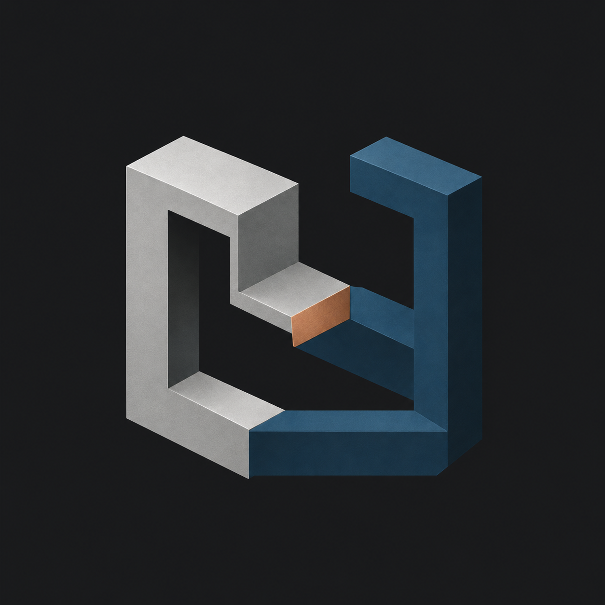

# Nexus 工程主题图标 J01–J06

日期：2026-11-03。状态：探索候选，未选定正式图标。

用户最新要求：高级感、工程感。围绕连接，以精密接合、承力结构、嵌合留白展开。沿用 logo-design 方法及内置 imagegen，共六张独立生成原图。

评审：优先 J03（模块接合）及 J05（简练嵌合）；J02 结构明确但字母过于直接；J01 材质效果重；J04 太像零件渲染；J06 透视及粗细较复杂。生成结果整体仍比提示词更具金属和立体效果，不能视为已经完成平面品牌设计。下一阶段应比较单色轮廓、小尺寸和浅色背景表现，再精修比例和接缝。不替换应用图标。

## 提示词及原图

通用提示词：

```text
Use case: logo-brand. Create ONE refined premium engineering app icon symbol for Nexus, a serious personal engineering and knowledge work platform. Core theme CONNECTION expressed through structural logic and precision joining. The user specifically requires understated luxury and engineering character. Design as a professionally crafted original industrial brand mark: disciplined proportions, stable silhouette, intentional tolerances, restrained palette, strong negative space, readable at small size. Square 1024x1024 canvas, centered mark about 60% of canvas on uniform very dark graphite background, no surrounding app tile. Vector-friendly clean graphic, mostly flat with only subtle tonal surfaces, no photorealistic metal texture, no chrome, no glossy 3D extrusion, no neon, no gradients used as decoration, no shadows, no letters or text, no labels, no watermark, no mockup, no gear, no wrench, no PCB traces, no bolts scattered around, no stock corporate logo imitation. Avoid friendly blobs, colorful petals and flowing ribbons. Specific concept: [specific concept below]
```

### J01 精密榫接



```text
Two machined solid structural members interlock with a precisely fitted offset dovetail joint, compact asymmetric square silhouette. Deep navy and satin titanium gray, one tiny cool-blue seam. The connection is visible through one generous angular negative space. Purposeful softened corners, flat graphic surfaces with exceptionally restrained tonal depth. No puzzle-piece lobes.
```

### J02 桥接构架



```text
A compact abstract load-bearing bridge joint: two strong vertical structural forms joined by a single diagonal rigid web, one open central aperture. Subtle forward tension with impeccable optical balance. Graphite and desaturated steel blue plus a tiny ivory joining face. Broad solid members, refined industrial geometry, no literal N requirement, no architecture illustration.
```

### J03 锁合模块



```text
Two complementary angular C-shaped solid components dock along a stepped precision seam, creating one distinctive near-square emblem with a generous open central cavity. Dark ink blue and brushed-silver-colored flat planes with a restrained ice-blue accent. Looks like a premium engineering instrument brand, no chain clipart, no hexagonal cube, no ribbon.
```

### J04 承力节点



```text
An abstract structural clevis joint, one substantial fork-shaped component receiving a single central solid member; use a small circular negative-space pin aperture as the memorable detail. Compact balanced emblem, graphite and muted cobalt with light platinum joining surface. All surfaces broad and clean, engineering precision without showing a literal hardware drawing.
```

### J05 精密嵌合



```text
A single compact rounded octagonal silhouette split into two interlocking solid pieces by one carefully designed stepped diagonal void. The void conveys connection and tolerance. Midnight blue and cool titanium gray, almost planar with discreet value contrast. No cube perspective, no gemstone, no generic shield, no circuitry decoration.
```

### J06 结构桥环



```text
A thick open rectangular structural frame with two opposing offsets connected by one short internal bridge. Unusual but elegant architectural silhouette, clear negative space, slight asymmetry. Flat platinum and deep petrol blue with a single tiny muted copper joint face. High-end scientific equipment identity, no infinity shape, no flowing band, no letter glyph.
```

