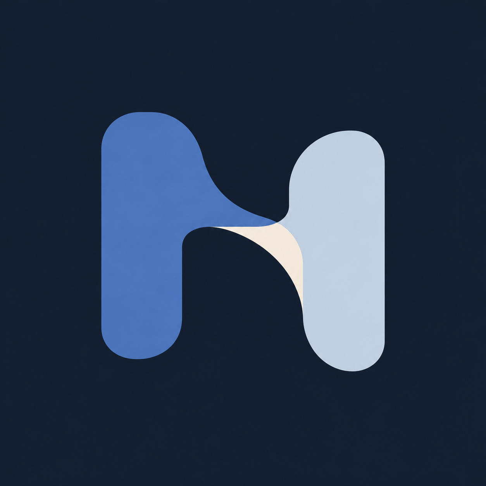
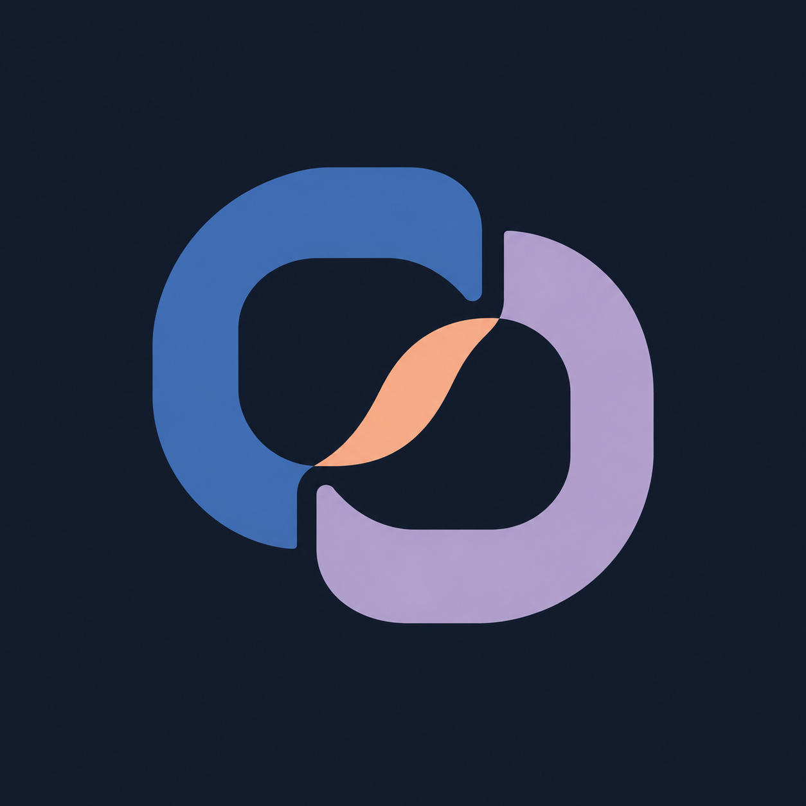

# Nexus 柔性工程图标 K01–K06

日期：2026-11-03。状态：概念探索。

用户反馈 J 系列过于生硬。本轮保留高级感、工程感与连接主题，通过适度圆角、自然曲线、低饱和配色折中，减少具体机械零件与金属效果。使用内置 imagegen 独立生成六个候选，沿用此前 logo-design 方法。

评审：优先 K02（结构与曲线的平衡）、K03（克制紧凑）、K05（轻盈连接）。K01/K06 中心连接偏细，缩小时易失真；K04 横长，图标占用率低；K02 仍有折带立体感，后续可简化；K03 内部尖端及 K05 交汇处需精修。未替换正式应用图标，尚未做小尺寸、单色及相似性验证。

## 完整提示词及原图

通用提示词：

```text
Use case: logo-brand. Create ONE original app icon symbol for Nexus, a premium personal knowledge and engineering work platform. Theme: CONNECTION. Balance precision with warmth, engineering clarity with graceful motion. Previous mechanical metal joint icons were too rigid; earlier flowing colorful ribbons were too soft. Find the middle: disciplined but supple geometry, confident silhouette, generous negative space, purposeful curves and restrained color. Professional boutique software identity, calm and refined. Square 1024x1024, centered mark occupying 62% on uniform very dark blue-gray background, no surrounding app tile. Mostly flat vector-like graphic, only very subtle tonal variation, clear at small size. No chrome, metal texture, bevels, extrusion, gear, bolts, circuitry, literal mechanical parts, sharp aggressive corners, neon, gloss, shadows, ribbon tails, petals, generic AI sparkles, text, numbers, labels, mockups or watermark. No forced hidden N. Specific concept: [specific concept below]
```

### K01 柔性桥接



```text
Two substantial softly squared upright forms joined by a gently curved diagonal bridge. The joins follow smooth tangent curves, subtly revealing the idea of two systems becoming one. Compact confident silhouette with an airy central opening. Flat muted ultramarine and pale blue-gray, one tiny warm ivory junction. Avoid a literal letter glyph.
```

### K02 弧面扣合


```text
Two complementary broad open links interlock once, using a distinctive combination of softly chamfered straight edges and generous flowing inner arcs. A compact slightly asymmetric emblem with one generous diagonal opening. Deep petrol and muted periwinkle, small porcelain joining face. Clear connection, no infinity shape or ordinary chain clipart.
```

### K03 共生接缝


```text
Two solid curved architectural forms fit together along a graceful offset seam; their combined outer contour is a compact softly rounded irregular square. Inner negative space is deliberate and open. Muted cobalt and warm stone, tiny sage accent. Subtle organic tension, precise construction, no yin-yang, no puzzle-piece lobes.
```

### K04 拱间连接


```text
A single abstract bridge emblem with two short softly tapered supports and a wide flowing saddle-shaped connecting span. Slight asymmetry gives motion and individuality, broad clear negative space below. Slate indigo and cool pale teal with a small soft ivory face. Nearly planar graphic, not a literal bridge drawing, not dumbbell shaped.
```

### K05 回环嵌合



```text
Two broad incomplete rounded rectangular loops meet through a single elegantly curved shared segment, compact almost circular silhouette, two clean openings. Carefully controlled line weights with relaxed natural curves. Deep marine blue and dusty lavender, small muted apricot connection. No orbit, no infinity, no metallic surface, no letterform.
```

### K06 流线结构


```text
A compact abstract structural junction with two curved solid outer members and one short diagonal connecting web. Each member blends a straight stable section into one smooth curved end. Refined poised asymmetry and excellent figure-ground balance. Muted royal blue and sage teal, tiny ivory joint. No swoosh, no printed letter, no knot.
```

